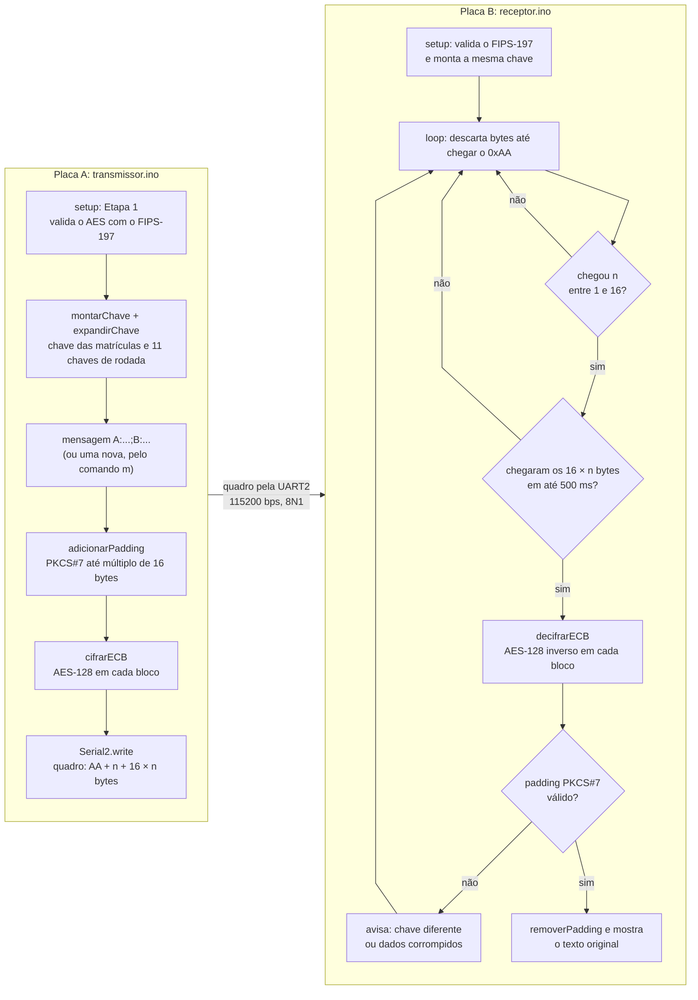
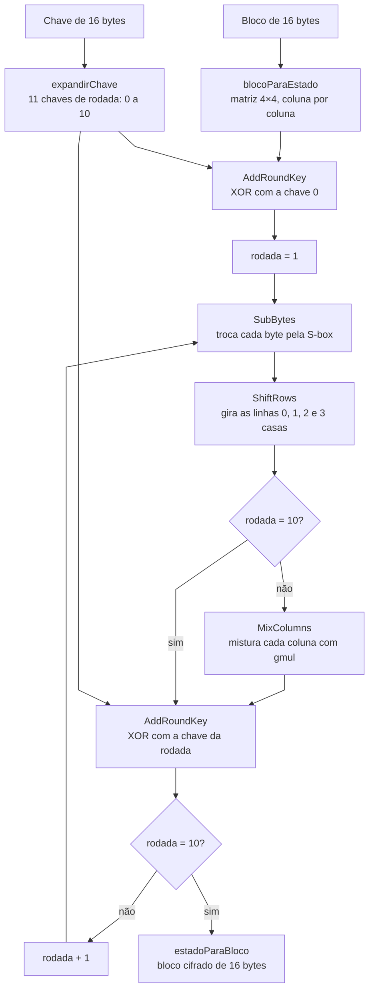

# AES-128 em dois ESP32 via UART

Trabalho prático de Segurança de Sistemas de Computação (IFMT).
AES-128 implementado do zero (sem biblioteca de criptografia), modo ECB com PKCS#7.
A placa A cifra a mensagem da dupla e envia pela UART2; a placa B decifra e mostra o texto.

## Fluxo

### Transmissor e receptor



### AES-128: cifrar um bloco (`cifrarBloco`)



A decifragem (`decifrarBloco`) faz o caminho inverso: começa pela chave 10 e vai até a 0,
usando InvShiftRows, InvSubBytes, AddRoundKey e InvMixColumns (que não entra no último passo).

## Estrutura

```
transmissor/
  transmissor.ino   placa A: autoteste, registros da Etapa 3, cifra e envia
  aes128.h          AES-128 (igual nas duas pastas)
receptor/
  receptor.ino      placa B: sincroniza no 0xAA, lê, decifra, remove PKCS#7
  aes128.h
teste_pc/
  teste.c           testes no PC (FIPS-197 + valores do enunciado)
```

## Antes de gravar

Troque as matrículas no topo **dos dois** `.ino` (têm que ser iguais):

```c
const char *MATRICULA_A = "20231001";
const char *MATRICULA_B = "20231002";
```

## Ligação (UART2, 115200 bps, 8N1)

| Placa A        | Placa B        |
|----------------|----------------|
| GPIO17 (TX2)   | GPIO16 (RX2)   |
| GPIO16 (RX2)   | GPIO17 (TX2)   |
| GND            | GND            |

## Quadro enviado

| Campo            | Tamanho     |
|------------------|-------------|
| Marcador `0xAA`  | 1 byte      |
| Nº de blocos `n` | 1 byte      |
| Blocos cifrados  | 16 × n bytes |

Enviado em bytes brutos (`Serial2.write`), não em texto hexadecimal.

## Comandos no Monitor Serial da placa A (115200, "Nova linha")

| Comando       | O que faz |
|---------------|-----------|
| Enter         | reenvia a mensagem da dupla e mostra a Etapa 3 dela |
| `m <texto>`   | cifra e envia uma mensagem nova |
| `k <n>`       | inverte o bit `n` (0..127) da chave e reenvia (o receptor acusa padding inválido) |
| `r`           | restaura a chave original |
| `a`           | efeito avalanche da última mensagem enviada |
| `e`           | demonstração do problema do ECB (bloco 1 = bloco 3) |

## Onde está cada parte do AES (`aes128.h`)

| Etapa | Função |
|-------|--------|
| Bloco ↔ matriz 4×4 | `blocoParaEstado` / `estadoParaBloco` |
| Expansão de chave | `expandirChave` (RotWord, SubWord e Rcon dentro dela) |
| AddRoundKey | `addRoundKey` |
| SubBytes / inversa | `subBytes` / `invSubBytes` (via `substituirBytes`) |
| ShiftRows / inversa | `shiftRows` / `invShiftRows` (via `girarLinhas`) |
| MixColumns / inversa | `mixColumns` / `invMixColumns` (via `multiplicarColunas`, matrizes `MIX` / `INV_MIX`) |
| Multiplicação em GF(2⁸) | `xtime`, `gmul` |
| Cifrar / decifrar 1 bloco | `cifrarBloco` / `decifrarBloco` |
| PKCS#7 | `adicionarPadding` / `removerPadding` |
| ECB | `cifrarECB` / `decifrarECB` |
| Chave das matrículas | `montarChave` |
| Validação FIPS-197 (nas duas placas) | `testarFIPS197` / `validarFIPS197` |

A S-box e a S-box inversa foram tiradas do FIPS-197 (NIST), Tabelas 4 e 6:
https://nvlpubs.nist.gov/nistpubs/FIPS/NIST.FIPS.197-upd1.pdf

## Teste no PC

```
cd teste_pc
gcc -I../transmissor teste.c -o teste && ./teste
```

Confere os vetores do FIPS-197 (Apêndices B e C.1), os 5 estados da rodada 1,
o exemplo do enunciado e os 3 blocos da demonstração do ECB. Também confere a origem das
tabelas fixas: a S-box (inverso em GF(2⁸) + transformação afim), o Rcon (`xtime` a partir de `01`)
e as matrizes do MixColumns (`MIX` × `INV_MIX` = identidade).
